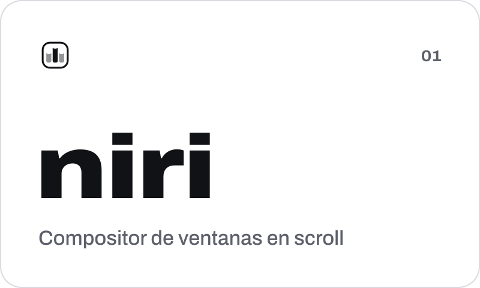
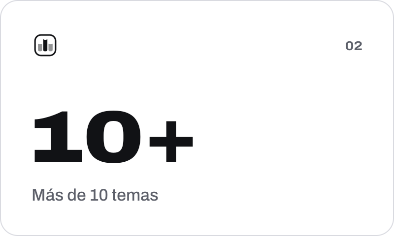
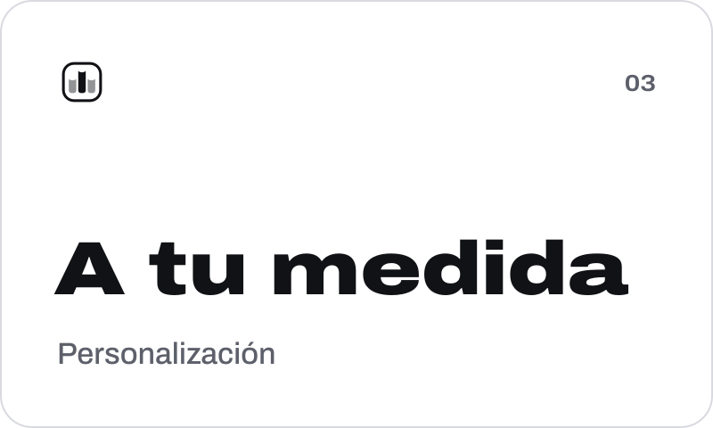

<p align="center">
  <picture>
    <source media="(prefers-color-scheme: dark)" srcset="assets/menisco-banner-dark.svg">
    
  </picture>
</p>

<p align="center"><i>El menisco es la curva que forma un líquido en el borde de su recipiente:<br>lo mismo que dibuja el liquid glass en el borde del vidrio.</i></p>

<br>

Un escritorio para **niri** hecho a mano con **Quickshell**: una isla dinámica con avisos, música con letra, acciones rápidas y rendimiento; un asistente animado y personalizable; un dock de vidrio; un lanzador que brota del dock; una barra lateral; una ventana de ajustes completa; y un aviso de volumen de líquido. Todo en grises, blanco y vidrio, con tipografía SF Pro y animaciones con rebote suave.

Funciona en niri normal (con desenfoque) y en **Lniri**, un niri modificado que agrega *liquid glass*, es decir, refracción real en los bordes del vidrio.

<p align="center">
  <picture><source media="(prefers-color-scheme: dark)" srcset="assets/readme/tarjeta-niri-oscuro.svg"></picture>
  <picture><source media="(prefers-color-scheme: dark)" srcset="assets/readme/tarjeta-temas-oscuro.svg"></picture>
  <picture><source media="(prefers-color-scheme: dark)" srcset="assets/readme/tarjeta-personalizacion-oscuro.svg"></picture>
</p>

<p align="center"><picture><source media="(prefers-color-scheme: dark)" srcset="assets/readme/readme-separador-con-logo-oscuro.svg"></picture></p>

## Qué trae

### Colores
Diez temas oscuros, que se eligen en **Ajustes > Apariencia > Color**: Ónix, Champán, Medianoche, Rubí, Jade, Fósforo (terminal ámbar), Aurora, Grafito (con cobre), Neón y Niebla (gris azulado, sin negro puro). Casi todos llevan dos tonos: uno para interruptores y barras, otro para el filo de lo encendido. Todo Menisco lee sus colores de una sola paleta (`Estilo.qml`), incluidas las notificaciones de Hokum: Menisco reescribe `~/.config/hokum/themes/menisco.kdl` cada vez que se cambia de tema.

### La isla
Muesca pegada al borde de arriba, con curvas continuas tipo *squircle*. La forma de la vista pequeña se elige en **Ajustes > Isla > Forma**: Clásica (de fábrica), Biselada, Octágono, Ola, Líquida, Recta o Píldora flotante. El cambio entre formas se anima, y al abrirse la isla pasa poco a poco de su forma a la del panel.

- **Reloj** al centro, en SF Pro Semibold con cifras de ancho fijo (12 o 24 horas, con o sin segundos).
- **Asistente** a la izquierda (ver más abajo).
- **Visualizador de audio** a la derecha: 5 barras redondeadas que siguen el sonido real (con [cava](https://github.com/karlstav/cava)). En silencio se convierten en una línea ondulada suave. Si hay una grabación o un temporizador en marcha, ahí sale su tiempo.
- **Huecos:** la isla pequeña tiene tres (izquierda, centro y derecha) y en **Ajustes > Isla > Isla pequeña** se elige qué va en cada uno: hora, hora con fecha, asistente, temperatura, uso de CPU, volumen, puntos de escritorios o la carátula de la canción. Lo de arriba es lo que trae de fábrica. Con **Ajustar contenido** encendido y solo uno o dos huecos ocupados, la isla se encoge al ancho justo de lo que muestra (uno solo queda al centro).

**Avisos.** La isla crece unos segundos y vuelve sola cuando:
- empieza una canción nueva (carátula y título);
- se conectan audífonos o bocinas Bluetooth (con su batería);
- se guarda una captura (miniatura, con botones Abrir y Carpeta);
- la CPU o la GPU pasan de cierta temperatura;
- un mando, unos audífonos o un ratón bajan de 20 % de batería;
- cambia la salida de audio (apagado de fábrica);
- termina el temporizador o se copia un color.

Si la isla está abierta, los avisos esperan en fila y salen al cerrarla. Con No molestar puesto no salen (menos temporizador y color, que los pide usted). Las notificaciones de las apps no pasan por la isla: las muestra [Hokum](https://hokum.app).

**Vista expandida.** Al pasar el cursor (o fija con un clic) crece hacia abajo con tres pestañas:
- **Música:** carátula grande (un clic lleva a la app), la isla teñida con el color del disco, barra de progreso que se arrastra, pastillas para elegir reproductor si suena más de uno, volumen de esa app, salida de audio (audífonos, bocinas, HDMI) y **letra sincronizada** abajo, que sube línea por línea con una ola, al estilo de Apple Music. La letra se busca en [LRCLIB](https://lrclib.net) y, si no está, en NetEase (`letra.sh`).
- **Acciones:** puede llevar una imagen de fondo que se funde hacia abajo (**Ajustes > Isla**, de `~/Imágenes/Wallpapers`). Captura de zona o de pantalla completa, grabar pantalla (`wf-recorder`), tomar un color de la pantalla, temporizador (1, 5, 10 o 25 min), historial del portapapeles, modo juego (ver abajo), micrófono, bloquear, siguiente fondo y una nota rápida.
- **Rendimiento:** consumo en vatios, uso y temperatura de la CPU y la GPU NVIDIA, perfil de energía y los programas que más gastan (`rendimiento.py`, solo corre mientras se ve).

### Asistente
Una carita con ojos proyectados en 3D sobre una esfera. Mira a su alrededor, parpadea y se duerme entre gestos para no gastar CPU. Y piensa: ver **Gota** más abajo.

- Seis emociones, cada una con su forma y su color. Cambiar de una a otra transforma la cabeza con un rebote:

  | Emoción | Forma | Color |
  |---|---|---|
  | `normal` | la de su gota | el de su gota |
  | `feliz` | cápsula | verde |
  | `escucha` | triángulo | azul |
  | `pensar` | gota | gris |
  | `emocion` | nube | naranja |
  | `confuso` | trébol | café |

  Para probarlas: `qs -p ~/.config/quickshell/isla ipc call asistente emocion feliz`
- **Gotas:** en Ajustes > Asistente se crean asistentes propios con nombre, una de 14 formas y uno de 11 colores. Se puede elegir que cambie de forma con las emociones o que solo cambien los ojos.
- En la isla abierta tiene un botón vertical con luz azul que gira y chispas (se puede apagar). Al pulsarlo se abre la conversación.

### Gota (el asistente que hace cosas)
Se le habla dentro de la isla, en el mismo marco que las pestañas: «acomoda mis descargas», «¿por qué no suena nada?», «¿qué ocupa espacio?». El cerebro es [OpenCode](https://opencode.ai) con un agente propio (`gota/agents/gota.md`: personalidad y reglas), por defecto con un modelo gratuito de OpenCode (`deepseek-v4.1-flash-free`; se cambia en la cabecera de ese archivo).

- **Mira sin pedir permiso, cambia solo con su visto bueno.** Para mover, renombrar, mandar a la papelera o reiniciar un servicio, propone un plan (carpetas, cuántos archivos) con **Cancelar** y **Hazlo**. Después ofrece **Deshacer**.
- **La IA nunca escribe nada.** Corre dentro de una caja de solo lectura (`bwrap`): aunque un comando se cuele, el sistema no la deja tocar archivos. Los planes los aplica `gota/gota-plan.py`, que no sale de la carpeta personal, nunca sobrescribe, nunca borra (usa la papelera) y solo acepta una lista cerrada de comandos. Nada con `sudo`: eso se lo dice a usted para que lo ejecute.
- **Avisa de fallos.** `gota/vigilar.sh` revisa cada minuto Bluetooth, sonido, portal del escritorio, la gráfica, el disco y los servicios de usuario; si algo cae, la isla lo muestra con un botón **Arreglar** que le pasa el problema a la Gota.
- Sus caras siguen la conversación: escucha mientras escribe, piensa mientras trabaja, feliz al terminar, confundida si falla. Si termina con la isla cerrada, avisa.
- Desde la terminal: `qs -p ~/.config/quickshell/isla ipc call gota_<monitor> preguntar "texto"` (también `abrir` y `cerrar`).

### Dock
- Vidrio esmerilado en niri; *liquid glass* en Lniri.
- Lupa al pasar el cursor, con rebote, y un punto debajo de las apps abiertas.
- Las apps abiertas que no están ancladas aparecen solas y el dock crece con animación.
- **Clic derecho:** Anclar al dock / Quitar del dock / Abrir / Cerrar. Las ancladas se guardan en `~/.config/quickshell/isla/dock.json`.
- Botón de cuadrícula que abre el lanzador (se aclara al pasar el cursor; no usa la lupa).
- **Material** (vidrio, sólido, ahumado, escarcha, tinte, contorno, Material You) y **forma** (redondeada, cápsula, biselada, octágono, ola, líquida, recta) en **Ajustes > Dock**. Sin vidrio y con el marco de pantalla encendido, el dock puede ir **pegado** al borde y fundirse con el marco.

### Lanzador (`Super+D` o el botón del dock)
Una píldora en el centro de la pantalla, con el asistente dentro. Al abrirse no muestra nada más; al escribir, la misma píldora crece hacia abajo con los resultados, el primero en grande. A igualdad, salen primero las apps que más abre.

- **Al escribir:**
  - **Apps:** por nombre, y también por descripción y palabras clave (`minecraft` encuentra Prism Launcher).
  - **Calculadora:** `12*8+4`; `Enter` copia el resultado.
  - **Acciones:** apagar y reiniciar (piden un segundo `Enter`), bloquear, cerrar sesión, captura, Bluetooth y No molestar con interruptor, y los ajustes de Menisco.
  - **Archivos** de la carpeta personal (con `plocate`).
  - **Emojis**, en español o en inglés y sin importar acentos (`fuego`, `fire`). Con `:` delante se muestran solo emojis.
  - **Web:** buscar en el navegador.
- El asistente reacciona a la búsqueda: piensa con varios resultados, se alegra con uno, se confunde si no hay nada.
- Flechas o `Tab` para moverse, `Enter` para abrir, `Escape` o un clic fuera para cerrar.

### Escritorio
- **Clic derecho en el fondo:** el fondo actual y los dos siguientes (clic para ponerlo), accesos rápidos (siguiente fondo, escritorio flotante, No molestar, modo juego, bloquear), atajos a las secciones de Ajustes y un botón grande de Ajustes.
- **Tres escritorios fijos** (`workspace "uno"`, `"dos"`, `"tres"` en la config de niri): existen aunque estén vacíos.
- **Escritorio flotante** (`Super+Alt+F`): las ventanas de ese escritorio dejan la fila y flotan; las nuevas también. La isla lo avisa.
- **Marco de pantalla** opcional (**Ajustes > Ventanas**): una orilla fina del color del tema alrededor de la pantalla, con la isla y los botones de las esquinas fundidos en ella.

### Vista general (`Super+O`)
La isla, el dock y los botones se encogen y se desvanecen; detrás de los escritorios queda el fondo desenfocado, y arriba a la izquierda sale un minimapa con cada escritorio y sus ventanas (clic para ir a una).

### Modo juego
Desde la isla, el lanzador o el clic derecho del escritorio. Pone el perfil de rendimiento, No molestar y evita que se suspenda; además **quita todas las animaciones y efectos**: Menisco pasa a instantáneo, niri apaga sus animaciones, sombras y desenfoque (escribe `~/.config/niri/juego.kdl`, que la config incluye al final) y el liquid glass de Lniri se apaga. El dock se queda. Al salir, todo vuelve como estaba, y si se cierra sesión con el modo puesto, Menisco lo limpia al arrancar.

### Pantalla de bloqueo (`Super+Alt+L`)
Fondo desenfocado, reloj grande, la Gota que reacciona a lo que se escribe (cada tecla le cambia forma y color), carátula y letra de lo que suena. Al desbloquear, la pantalla sube como una hoja de vidrio.

### Modo captura (`Super+Shift+S`)
La pantalla se congela y se elige qué capturar: **Zona** (se arrastra, se mueve y se estira por las esquinas), **Ventana** (de una lista: niri no dice dónde está cada ventana) o **Pantalla**. La zona puede tener **forma**: rectángulo, círculo, triángulo, corazón o lazo a mano; lo de fuera queda transparente en la imagen. Opciones de incluir el cursor y abrir en `swappy` para anotar. Se guarda en `~/Pictures/Screenshots`, se copia y la isla muestra la miniatura. `ImprPant` sigue con la captura de niri, por si Quickshell no está corriendo.

### Tabla de atajos y salir
`Super+Shift+/` abre una tabla de atajos propia, en cuatro grupos, que lee las teclas de la config de niri cada vez. `Super+Shift+E` abre un cuadro para salir de niri (`Enter` sale, `Esc` cancela); `Ctrl+Alt+Supr` sigue con el de niri. Los dos siguen el tema de color.

### Novedades
Después de cada actualización sale una ventanita centrada, encima de todo y siempre en el tema Ónix, con lo nuevo: primero en pequeño con las tres torres del logo, que se encienden por turnos hasta que la del centro sale con rebote; luego crece, el título salta letra por letra y al final entra lo demás en cascada. Sale una sola vez por versión; la lista está en `quickshell/isla/novedades.json` (al cambiar su `version`, vuelve a salir). A mano: `qs -p ~/.config/quickshell/isla ipc call novedades abrir`.

### Bandeja
Píldora con los iconos de las apps en segundo plano. Va en el hueco que tenga en **Ajustes > Botones**. Clic derecho abre el menú de la app.

### Botones de las esquinas
A la altura de la isla, en las dos esquinas de arriba. En **Ajustes > Botones** se eligen y se ordenan: Menisco (ajustes), barra lateral, bandeja, lanzador, captura, No molestar, modo juego, vista general, escritorio flotante, bloquear y siguiente fondo. De fábrica: el logo de Menisco en una esquina, y la bandeja y la estrella de la barra lateral en la otra.

### Barra lateral (`Super+A`)
Centro de control que entra por un lado de la pantalla: botones rápidos (Wi-Fi, Bluetooth, No molestar, Modo café y más), volumen, música, calendario y energía, con páginas propias para Bluetooth, Wi-Fi y sonido. También se abre con el botón de estrella de la esquina o acercando el cursor al borde.

### Ajustes (`Super+.`)
Ventana flotante centrada con una sombra suave detrás. Se guardan en `~/.config/quickshell/isla/menisco.json`; lo que vive en niri lo escribe `menisco-niri.py` (y lo valida antes de guardar). Las páginas largas (Apariencia, Isla, Dock, Notificaciones y Asistente) se parten en dos pestañas arriba, para no tener que bajar tanto.
- **Inicio:** buscador que lleva a cualquier ajuste y lo ilumina; fondo de pantalla actual con el selector encima (lee `~/Imágenes/Wallpapers`; se cambia en `Ajustes.qml`); datos del equipo (memoria, gráfica, tiempo encendido, versión de Menisco), y accesos directos a lo que más se cambia.
- También se abren con el botón del logo de Menisco, arriba a la izquierda (en la esquina contraria a la barra lateral).
- **Apariencia:** **perfiles** (guardan toda la apariencia —tema, dock, isla, botones, marco, ventanas y vidrio— y se aplican con un clic; clic derecho para renombrar, actualizar o borrar), tema de color, velocidad y rebote de las animaciones, tipografía, esquinas, espacio entre ventanas.
- **Pantallas**, **Liquid glass** y **Atajos** (se graban pulsando la combinación).
- **Isla:** forma, imagen de fondo de Acciones, qué muestra, cómo se abre y en qué pestaña, y opciones de la pestaña Música.
- **Notificaciones:** No molestar (también automático en pantalla completa y al grabar), qué avisos salen en la isla, qué apps no avisan de la canción que suena, y lo de Hokum: posición, duración, cuántas a la vista y, por app, ocultarla o dejarla pasar aunque esté No molestar. Lo de Hokum lo escribe `menisco-hokum.py` en `~/.config/hokum/config.kdl` (lo valida con `hokum check` antes de guardar).
- **Asistente:** sus gotas, carácter y el botón de luz.
- **Barra lateral:** lado, alto, ancho, y una miniatura donde se reordenan las secciones arrastrándolas.

### Aviso de volumen
Cápsula pequeña sobre el dock que se llena de líquido con el borde ondulado. Aparece al cambiar el volumen y se va sola.

<p align="center"><picture><source media="(prefers-color-scheme: dark)" srcset="assets/readme/readme-separador-linea-oscuro.svg"></picture></p>

## Requisitos

| Qué | Para qué |
|---|---|
| [niri](https://github.com/niri-wm/niri) 26.04 o más nuevo | el compositor |
| [Quickshell](https://quickshell.org) 0.3 | la isla, el dock, los ajustes y el aviso de volumen |
| [awww](https://codeberg.org/LGFae/awww) | el fondo de pantalla |
| [Hokum](https://hokum.app) | las notificaciones (y su No molestar) |
| [cava](https://github.com/karlstav/cava) | el visualizador de audio |
| `plocate`, `wl-clipboard`, `python3` | archivos, copiar resultados y emojis, archivos recientes |
| `grim`, `python3-pillow`, `swappy` | modo captura: congelar la pantalla, recortar con forma, anotar |
| `curl`, `jq` | letras de canciones |
| `wf-recorder`, `cliphist`, `swaylock` | grabar pantalla, historial del portapapeles, bloquear |
| PipeWire, BlueZ, NetworkManager, `power-profiles-daemon` | volumen, Bluetooth, Wi-Fi y perfil de energía |
| `nvidia-smi` (opcional) | datos de la GPU en Rendimiento |
| [OpenCode](https://opencode.ai), `bubblewrap` (`bwrap`), `gio` | la Gota: su cerebro, su caja de solo lectura y la papelera |
| Tipografía **SF Pro** | textos (ver la nota de abajo) |
| [Material Symbols Rounded](https://github.com/google/material-design-icons) (fuente variable) | iconos |
| Tema de iconos [WhiteSur](https://github.com/vinceliuice/WhiteSur-icon-theme) | iconos del dock (opcional) |

> **Sobre SF Pro:** es de Apple, se descarga gratis en [developer.apple.com/fonts](https://developer.apple.com/fonts/), pero su licencia solo permite usarla para diseñar apps para dispositivos de Apple. Este repo **no** la incluye. Si no la instala, Qt usará otra fuente; Inter Display es un buen sustituto (cambie `"SF Pro Text"` en los `.qml`).

<p align="center"><picture><source media="(prefers-color-scheme: dark)" srcset="assets/readme/readme-separador-linea-oscuro.svg"></picture></p>

## Instalación

```bash
git clone https://github.com/KratozZ12/menisco-dots
cd menisco-dots
./instalar.sh
```

`instalar.sh` copia todo a `~/.config`. Si ya tenía una configuración de niri, Hokum o `quickshell/isla`, la renombra a `*.antes-de-menisco` y se lo dice.

Después, revise en `~/.config/niri/config.kdl`:
- los bloques `output` (nombres y posición de **sus** monitores);
- las líneas de **KWallet** y del agente de polkit de KDE: si no usa KDE, bórrelas o cámbielas por las de su escritorio.

### Lniri (opcional, para el liquid glass)

```bash
./lniri/compilar.sh
```

Compila niri 26.04 con los archivos de [TattvaOrg/Lniri](https://github.com/TattvaOrg/Lniri) y lo instala como una sesión aparte, **"Lniri (Liquid Glass)"**. El niri normal no se toca. Lniri lee `~/.config/lniri/config.kdl`, que incluye la configuración de niri y le suma `vidrio.kdl` (el botón *Liquid glass* de los ajustes copia o vacía ese archivo).

> El *liquid glass* solo se ve detrás de lo que es transparente: el dock, terminales con transparencia y otras piezas de Quickshell. Las ventanas opacas lo tapan.

<p align="center"><picture><source media="(prefers-color-scheme: dark)" srcset="assets/readme/readme-separador-linea-oscuro.svg"></picture></p>

## Atajos

| Atajo | Qué hace |
|---|---|
| `Super+.` | abrir/cerrar los ajustes |
| `Super+D` | lanzador |
| `Super+A` | barra lateral |
| `Super+T` | terminal |
| `Super+Q` | cerrar ventana |
| `Super+O` | vista general |
| `Super+Shift+S` | modo captura |
| `Super+Shift+/` | tabla de atajos |
| `Super+Shift+E` | salir de niri |
| `Super+Alt+L` | bloquear |
| `Super+Alt+F` | escritorio flotante o en fila |

El resto son los atajos de fábrica de niri.

<p align="center"><picture><source media="(prefers-color-scheme: dark)" srcset="assets/readme/readme-separador-linea-oscuro.svg"></picture></p>

## Cosas que conviene saber

- **Si usa también Plasma u otro escritorio en la misma máquina:** Hokum (y mako, si lo tiene) pueden quitarle las notificaciones al otro escritorio, porque arrancan solos cuando llega una notificación. Aquí niri lo arranca a mano; para bloquear el arranque automático:
  ```bash
  systemctl --user mask hokum.service
  ```
  y cree `~/.local/share/dbus-1/services/app.hokum.Notifications.service` con el `Exec=` del servicio de notificaciones de su otro escritorio.
- **Sin un programa de notificaciones**, algunas apps (como la de escritorio de Claude) se congelan esperando respuesta. No quite Hokum sin poner otro.
- **No molestar** lo guarda Hokum; los interruptores de Menisco (ajustes, barra, lanzador, modo juego) lo cambian con `hokum dnd`.
- **Gota y privacidad:** lo que le pide a la Gota, y lo que ella lee para contestar (nombres de archivos, registros del sistema), va al servidor del modelo que use OpenCode. Con los modelos gratuitos, revise qué hace OpenCode con esos datos.
- **Letras:** para buscar la letra, la isla manda el título y el artista de la canción a LRCLIB y, si no la encuentra, a NetEase (un servicio de China). Las dos se pueden apagar en Ajustes > Isla.
- **Quickshell a la frecuencia del monitor:** niri lo lanza con `QSG_RENDER_LOOP=threaded`; sin eso, Qt anima a 60 fps aunque el monitor vaya a 144.
- **El fondo de awww vive en el *backdrop* de niri:** por eso el fondo de los espacios de trabajo es transparente en la configuración.

<p align="center"><picture><source media="(prefers-color-scheme: dark)" srcset="assets/readme/readme-separador-linea-oscuro.svg"></picture></p>

## Créditos

- [niri](https://github.com/niri-wm/niri) y [Lniri](https://github.com/TattvaOrg/Lniri) por el compositor y el *liquid glass*.
- [Quickshell](https://quickshell.org).
- [Hokum](https://hokum.app), [cava](https://github.com/karlstav/cava), [awww](https://codeberg.org/LGFae/awww), [LRCLIB](https://lrclib.net).
- Iconos: Material Symbols (Google) y WhiteSur.

<p align="center"><picture><source media="(prefers-color-scheme: dark)" srcset="assets/readme/readme-separador-linea-oscuro.svg"></picture></p>

## Licencia

[MIT](LICENSE). Lniri (que `lniri/compilar.sh` descarga y compila) tiene su propia licencia, GPL-3.0.

<br>

<p align="center"><picture><source media="(prefers-color-scheme: dark)" srcset="assets/readme/readme-encabezado-oscuro.svg"></picture></p>
